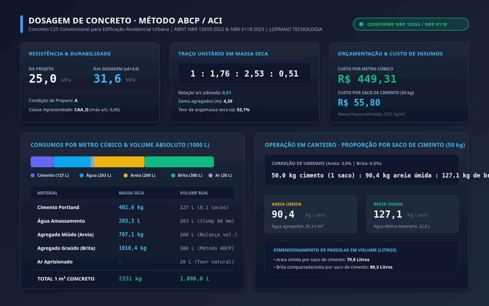

# Dosagem de Concreto ABCP · ABNT NBR 12655 & NBR 6118

[](https://github.com/martinlofranodeoliveira/dosagem-concreto-abcp/actions/workflows/ci.yml)
[](https://www.python.org/downloads/)
[-brightgreen.svg)](#garantia-de-aritmética-exata-zero-float)
[](#fundamentação-técnica-e-normativa)
[](LICENSE)

Motor determinístico e analítico para dimensionamento experimental de traços de concreto de cimento Portland pelo **Método ABCP / ACI**, rigorosamente em conformidade com as normas **ABNT NBR 12655:2022** (*Preparo, controle, recebimento e aceitação de concreto de cimento Portland*) e **ABNT NBR 6118:2023** (*Projeto de estruturas de concreto*).

Implementado inteiramente em **Python 3.11+ puro**, com **zero dependências externas de runtime** e **aritmética racional 100% livre de ponto flutuante** (`float`). Todas as interpolações, balanços de volume absoluto e composições de custos utilizam frações exatas (`fractions.Fraction`) e grandezas inteiras.

---

## Painel Visual de Engenharia

O motor gera painéis vetoriais SVG de 1440 × 900 pixels e exportações em alta resolução com o balanço volumétrico, o traço unitário em massa seca, a proporção de canteiro por saco de 50 kg corrigida para a umidade dos agregados e a composição de custos:



---

## Fundamentação Técnica e Normativa

### 1. Resistência Média de Dosagem ($f_{cm}$) — ABNT NBR 12655:2022
A resistência de dosagem aos 28 dias é calculada para assegurar que não mais de 5% dos corpos-de-prova ensaiados fiquem abaixo da resistência característica de projeto ($f_{ck}$):

$$f_{cm} = f_{ck} + 1,65 \times s_d$$

O desvio-padrão de dosagem ($s_d$) é determinado pela **Condição de Preparo**:
- **Condição A ($s_d = 4,0$ MPa):** Cimento e agregados medidos em massa; água de amassamento corrigida rigorosamente pela umidade dos agregados. Aplicável a qualquer $f_{ck} \ge 10$ MPa.
- **Condição B ($s_d = 5,5$ MPa):** Cimento medido em massa; agregados em volume; água corrigida pela umidade da areia. Permitida para $f_{ck} \le 25$ MPa.
- **Condição C ($s_d = 7,0$ MPa):** Agregados em volume e água sem controle sistemático. Permitida exclusivamente para $f_{ck} \le 15$ MPa.

### 2. Relação Água/Cimento ($a/c$) e Durabilidade Ambiental — NBR 6118:2023
O fator $a/c$ adotado é o menor valor entre o exigido pela resistência mecânica (Curva de Abrams) e o teto normativo imposto pela Classe de Agressividade Ambiental (CAA):

$$a/c_{\text{adotado}} = \min(a/c_{\text{resistência}}, a/c_{\text{durabilidade}})$$

| Classe de Agressividade (CAA) | Agressividade | Relação $a/c$ Máxima (CA) | $f_{ck}$ Mínimo (CA) | Consumo Mínimo de Cimento |
|---|---|---|---|---|
| **CAA I** | Fraca (Rural / Submersa) | 0,65 | 20 MPa (C20) | 260 kg/m³ |
| **CAA II** | Moderada (Urbana) | 0,60 | 25 MPa (C25) | 280 kg/m³ |
| **CAA III** | Forte (Marinha / Industrial) | 0,55 | 30 MPa (C30) | 320 kg/m³ |
| **CAA IV** | Muito Forte (Respingos de maré) | 0,45 | 40 MPa (C40) | 360 kg/m³ |

### 3. Consumo de Água e Volume de Brita ($V_{ob}$) — Método ABCP/ACI
- O consumo de água de amassamento ($C_a$ em L/m³) é obtido pela tabela empírica da ABCP em função da consistência (abatimento do tronco de cone / *slump*) e da dimensão máxima característica da brita ($d_{\max}$), com suporte a aditivos plastificantes redutores de água.
- O consumo de agregado graúdo ($C_b$) é calculado pelo volume aparente compactado de brita seca ($V_{ob}$) por metro cúbico de concreto, interpolado bilinearmente em função do módulo de finura ($MF$) da areia e de $d_{\max}$:

$$C_b = V_{ob} \times \gamma_{\text{unit, compactada}}$$

### 4. Balanço do Volume Absoluto (1000 Litros)
Para 1 metro cúbico ($1000$ L) de concreto fresco adensado:

$$V_c + V_a + V_b + V_{\text{areia}} + V_{\text{ar}} + V_{\text{aditivo}} = 1000 \text{ L}$$

O consumo em massa de areia seca é obtido isolando $V_{\text{areia}}$ e multiplicando pela massa específica real dos grãos ($\gamma_{\text{real, areia}}$).

### 5. Correção de Umidade de Canteiro e Traço por Saco de Cimento
Na prática de obra, os agregados contêm umidade livre que reduz a água a adicionar na betoneira e aumenta a massa úmida dos agregados:

$$\Delta A = C_{\text{areia}} \times h_{\text{areia}} + \sum C_{b_i} \times h_{b_i}$$
$$C_{a,\text{efetiva}} = C_a - \Delta A$$

O traço operacional é fornecido diretamente para **1 saco de cimento de 50 kg**, incluindo conversão opcional em **volume de padiolas (Litros)** caso informadas as massas unitárias soltas e o coeficiente de inchamento da areia ($I_a$).

---

## Garantia de Aritmética Exata (Zero Float)

A biblioteca implementa uma política de **tolerância zero para ponto flutuante IEEE-754**:
1. Todos os cálculos matemáticos utilizam `fractions.Fraction` e inteiros (`int`).
2. O decodificador JSON canônico rejeita ativamente qualquer entrada em notação de ponto flutuante através de `parse_float=rejeitar_float`.
3. Os valores monetários são mantidos em frações exatas e formatados com arredondamento determinístico *half-up* inteiramente inteiro.
4. Exportações CSV implementam sanitização ativa contra *CSV Injection* (prefixo `'` para células iniciadas por `=`, `+`, `-`, `@`, `\t` ou `\r`).
5. O pacote ZIP determinístico utiliza atributos de data e hora fixos (`2026-01-01 00:00:00`), permissões canônicas (`0o100644`) e gravação com `os.O_EXCL` para evitar sobrescritas acidentais.

---

## Instalação

Como o projeto requer exclusivamente a biblioteca padrão do Python 3.11+, nenhuma dependência de terceiros é necessária:

```bash
# Instalação direta do repositório
pip install git+https://github.com/martinlofranodeoliveira/dosagem-concreto-abcp.git

# Ou via wheel da release oficial v1.0.0
pip install dosagem_concreto_abcp-1.0.0-py3-none-any.whl
```

---

## Guia de Uso da Linha de Comando (CLI)

O pacote instala o utilitário de linha de comando `dosagem-concreto`:

```bash
# Exibir versão e informações da LOFRANO TECNOLOGIA
dosagem-concreto versao

# Exibir tabelas normativas e limites ABCP / NBR
dosagem-concreto tabelas

# Gerar arquivo JSON de exemplo pronto para preenchimento
dosagem-concreto modelo --saida meu_concreto.json

# Calcular dosagem com exportação de todos os relatórios e pacote ZIP
dosagem-concreto calcular exemplares/caso_c25_obra_urbana.json \
  --saida-json resultado.json \
  --saida-md memorial.md \
  --saida-csv tabela_consumos.csv \
  --saida-svg painel.svg \
  --saida-zip pacote_completo.zip
```

### Exemplo de Saída no Terminal:

```text
========================================================================
DOSAGEM DE CONCRETO · MÉTODO ABCP/ACI (ABNT NBR 12655 / NBR 6118)
Identificação: Concreto C25 Convencional para Edificação Residencial Urbana
========================================================================
fck solicitado:       25,00 MPa
Desvio-padrão (sd):   4,00 MPa (A)
fcm dosagem:          31,60 MPa
Relação a/c adotada:  0,505 (Condicionada pela resistência mecânica de dosagem (fcm).)
------------------------------------------------------------------------
TRAÇO SECO EM MASSA:  1 : 1,76 : 2,53 : 0,51
Soma agregados (m):   4,29
Teor de argamassa:    52,1%
------------------------------------------------------------------------
CONSUMOS PARA 1 m³ DE CONCRETO:
  • Cimento:          402,6 kg (8,05 sacos de 50 kg)
  • Água:             203,3 L (Slump 80 mm)
  • Areia seca:       707,1 kg
  • Brita seca total: 1018,4 kg
  • Massa fresca:     2331 kg/m³
------------------------------------------------------------------------
CANTEIRO (POR SACO DE 50 kg COM CORREÇÃO DE UMIDADE):
  50,0 kg cimento (1 saco) : 90,4 kg areia úmida : 127,1 kg de brita : 22,0 L de água a adicionar
------------------------------------------------------------------------
CUSTOS ESTIMADOS:
  • Custo por m³:     R$ 449,31
  • Custo por saco:   R$ 55,80
========================================================================
```

---

## Uso como Biblioteca Python

```python
from fractions import Fraction
from dosagem_concreto_abcp import (
    AgregadoGraudo,
    AgregadoMiudo,
    Cimento,
    ClasseAgressividadeAmbiental,
    CondicaoPreparo,
    ParametrosDosagem,
    PrecosUnitarios,
    TipoCimento,
    TipoEstrutura,
    calcular_dosagem_abcp,
    formatar_traco_saco_50kg,
    formatar_traco_unitario,
)

# Configuração dos parâmetros com Frações Racionais Exatas
parametros = ParametrosDosagem(
    identificacao="Pilar C30 Edifício Central",
    fck_mpa=Fraction(30, 1),
    condicao_preparo=CondicaoPreparo.A,
    classe_agressividade=ClasseAgressividadeAmbiental.CAA_II,
    tipo_estrutura=TipoEstrutura.CONCRETO_ARMADO,
    slump_mm=100,
    cimento=Cimento(
        tipo=TipoCimento.CP_II_32,
        massa_especifica_real_kg_l=Fraction(315, 100),
    ),
    areia=AgregadoMiudo(
        nome="Areia Média Lavada",
        modulo_finura=Fraction(24, 10),
        massa_especifica_real_kg_l=Fraction(263, 100),
        umidade_pct=Fraction(3, 1),
    ),
    britas=(
        AgregadoGraudo(
            nome="Brita 1",
            d_max_mm=Fraction(19, 1),
            massa_unitaria_compactada_kg_m3=Fraction(1520, 1),
            massa_especifica_real_kg_l=Fraction(268, 100),
            umidade_pct=Fraction(5, 10),
        ),
    ),
    precos=PrecosUnitarios(
        cimento_por_saco_50kg=Fraction(3850, 100),
        areia_por_metro_cubico=Fraction(120, 1),
        brita_por_metro_cubico=Fraction(110, 1),
        agua_por_metro_cubico=Fraction(85, 10),
    ),
)

# Execução da dosagem analítica
resultado = calcular_dosagem_abcp(parametros)

print("Traço Seco:", formatar_traco_unitario(resultado.traco_seco))
print("Canteiro:", formatar_traco_saco_50kg(resultado.ajuste_canteiro))
print(f"Custo total: R$ {resultado.custos.custo_total_m3}")
```

---

## Verificação Independente e Suíte de Testes

O repositório inclui:
1. **73 Testes Unitários Automatizados** cobrindo todas as equações, condições de contorno, casos degenerados, codec JSON canônico e empacotamento determinístico:
   ```bash
   python -m unittest discover -s tests -v
   ```
2. **Auditor Independente em SQLite (`tools/verify_independent.py`)**:
   Uma ferramenta autônoma que **não importa o pacote de produção**, instancia um banco relacional SQLite em memória, popula as tabelas normativas e audita bit a bit os resultados:
   ```bash
   python tools/verify_independent.py exemplares/caso_c25_obra_urbana.json
   ```

---

## Integração Contínua (CI)

O workflow do GitHub Actions testa todas as alterações em:
- **Ubuntu:** Python 3.11, 3.12, 3.13 e 3.14
- **Windows:** Python 3.14
- **Ambiente Isolado de Rede (`unshare -r -n`):** Verificação de integridade fora da árvore de código e garantia de zero chamadas de rede.

---

## Licença

Distribuído sob a licença **MIT**. Consulte o arquivo [LICENSE](LICENSE) para mais detalhes.

Copyright (c) 2026 **Martin Lofrano de Oliveira** — [Lofrano Tecnologia](https://lofranotecnologia.com.br)
